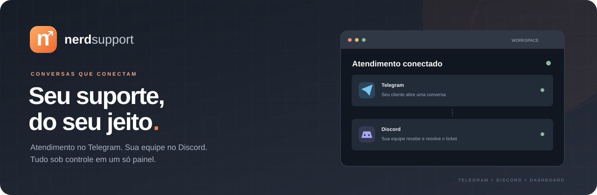
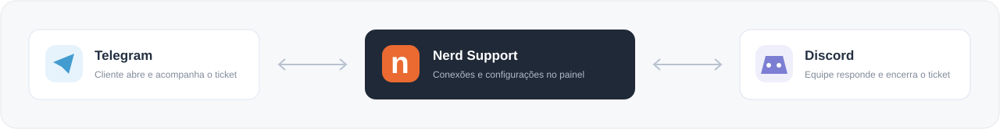

<p align="center"><strong>Tickets no Telegram. Atendimento no Discord. Gestão em um dashboard autenticado.</strong></p>
<p align="center">Node.js 24.15+ · JavaScript ESM · Express · Better Auth · SQLite</p>
<p align="center"><a href="#executar">Começar</a> · <a href="#funcionalidades">Funcionalidades</a> · <a href="#dados-locais">Dados e segurança</a> · <a href="docs/produto.md">Visão do produto</a></p>



# Nerd Support

Bot de suporte que recebe tickets no Telegram e encaminha conversas e imagens para canais no Discord. Suporta português, inglês e espanhol.

Nerd Support é a identidade do produto. O nome usado como prefixo das mensagens pode ser personalizado no dashboard; o valor padrão é `Nerd Support`. Essa configuração não altera o nome ou o username da conta do bot nas plataformas.

O dashboard autenticado local está implementado; a gestão de vários clientes ainda está planejada. O escopo e a evolução da arquitetura estão em [Visão do produto](docs/produto.md).

## Funcionalidades

- **Atendimento com botões:** abrir ticket, consultar atendimento, acessar ajuda e escolher idioma no Telegram.
- **Conversa entre plataformas:** textos e imagens encaminhados entre o cliente no Telegram e a equipe no Discord.
- **Canais por ticket:** criação, sincronização e arquivamento no Discord.
- **Dashboard autenticado:** primeiro acesso, login, logout e configurações de identidade e integrações.
- **Controles de operação:** validar credenciais, conectar, parar e acompanhar o estado dos bots.
- **Diagnóstico por etapa:** mensagens específicas para token inválido, servidor não encontrado, permissões e falhas de rede.
- **Dados persistentes:** contas, configurações e auditoria em SQLite; tickets e idiomas em JSON.
- **Três idiomas:** português, inglês e espanhol.

## Executar

Requer Node.js 24.15 ou superior.

1. Instale as dependências com `npm ci`.
2. Antes do primeiro cadastro, configure `SETUP_CODE` no `.env` com um valor aleatório de pelo menos 32 caracteres.
3. Execute `npm start` e abra **http://127.0.0.1:3000**.
4. Crie o administrador com nome, e-mail, senha e código de instalação.
5. Entre no painel, preencha identidade, tokens e IDs, e salve.
6. Clique em **Validar integrações** e depois **Conectar bots**.

Sem `SETUP_CODE`, o cadastro inicial fica bloqueado. Contas existentes continuam acessíveis sem o código de instalação. Os tokens dos bots são cadastrados pelo dashboard e não precisam ficar no `.env`.

A versão atende **um cliente e um administrador por instalação**, localmente ou em servidor com armazenamento persistente. Após reiniciar, conecte os bots pelo painel. Pare os bots antes de alterar as configurações; tokens vazios no formulário mantêm as credenciais existentes.

`npm run dev` reinicia ao editar o código; gravações de tickets e configurações não reiniciam a aplicação.

## Testar o atendimento real

1. No Discord Developer Portal, habilite **Message Content Intent** e adicione o bot ao servidor com permissões para visualizar canais, enviar mensagens, incorporar links, anexar arquivos, ler histórico e gerenciar canais.
2. Cadastre os tokens de Telegram e Discord e o ID do servidor no painel. Categorias, cargo de moderadores e canal de fallback são opcionais. As categorias de ativos e arquivados precisam ser diferentes.
3. Salve, valide e conecte. O estado da conexão é atualizado no dashboard.
4. No Telegram, abra seu bot e envie `/start` e `/novoticket`. Informe assunto e descrição.
5. Confira o canal criado no Discord e responda nele. A resposta deve chegar ao Telegram.
6. Envie imagens nas duas direções e feche o ticket para testar o arquivamento.

O painel também permite enviar uma mensagem de teste ao ID numérico de um usuário Telegram. Esse usuário deve ter iniciado uma conversa com o bot. O teste de envio isolado não substitui o teste completo de um ticket.

## Dados locais

Contas, sessões, auditoria e configurações ficam em `data/nerd-support.sqlite`. As configurações são criptografadas com AES-256-GCM e a chave é gerada em `data/server.key`. Os tokens não são retornados ao navegador. Faça backup do banco **junto com a chave** e proteja o acesso à pasta. Perder a chave impede recuperar as credenciais salvas.

`data/` é ignorado pelo Git. Tickets e idiomas também ficam nesse diretório, em `active_tickets.json` e `user_languages.json`. Na primeira inicialização da nova versão, JSONs legados na raiz são copiados para o diretório de dados, sem substituir arquivos existentes ou apagar os originais. Não há isolamento de vários clientes nesta versão.

Os arquivos de atendimento `active_tickets.json` e `user_languages.json` também são ignorados pelo Git e são criados localmente quando necessários. Não envie arquivos de banco, chaves, backups, logs, cookies ou capturas de tela com dados reais ao repositório. As imagens deste README são ilustrações sem dados de clientes.

Localmente, o servidor escuta em `127.0.0.1`; no Railway/produção, em `0.0.0.0` usando `PORT`. `NERD_DATA_DIR` define o diretório de todos os dados. Em produção, configure `DASHBOARD_URL` com a origem HTTPS exata. Múltiplos clientes e recuperação de senha por e-mail continuam sendo etapas futuras.

## Implantar no Railway

Veja o [guia de implantação](docs/railway.md) para volume persistente, variáveis, código de instalação, HTTPS e healthcheck. A aplicação bloqueia o cadastro sem código e recusa iniciar no Railway sem volume persistente.

## Organização

```text
complete-bot.js          Entrada compatível com npm start
src/
  app.js                Inicialização e encerramento
  config.js             Carregamento e validação do .env
  clients.js            Clientes Telegram/Discord e referências do servidor
  state.js              Tickets, sessões, contadores e idiomas em memória
  storage/              Leitura e gravação dos arquivos JSON
  services/tickets.js   Criação, busca, mensagens e fechamento de tickets
  i18n/                 Traduções e preferência de idioma
  utils/markdown.js     Escape de Markdown
  telegram/
    index.js            Registro de comandos, ações e eventos
    handlers/           Uma função nomeada por comando, ação ou evento
    api.js              Envio de mensagens e imagens pela API
    photos.js           Processamento de fotos recebidas
  discord/
    index.js            Registro dos eventos do Discord
    handlers/           Pronto, mensagens e interações
    channels.js         Criação de canais e sincronização dos tickets
    messages.js         Envio de textos e imagens
    replies.js          Função de resposta do suporte por ID de ticket
  dashboard/            Autenticação, SQLite, credenciais, runtime e interface
  http.js               Dashboard e API autenticada
test/bot.test.js         Regressão dos fluxos sem conexões externas
```

Para adicionar um comando, crie uma função em `src/telegram/handlers/` e registre-a em `src/telegram/index.js`. Os manipuladores usam os serviços e compartilham o estado de `src/state.js`; a persistência permanece em `storage/`.

O `.env` opcional é resolvido a partir da raiz do projeto. Os arquivos `active_tickets.json` e `user_languages.json` são lidos e gravados no diretório de dados configurado, cujo padrão é `data/` na raiz do projeto.

## Verificação

Execute `npm test`. Os testes usam diretório temporário, clientes simulados e respostas HTTP simuladas para validar criação, respostas, imagens, fechamento, sincronização, idiomas e persistência. Eles não iniciam os bots nem alteram os JSONs do projeto. A validação com Telegram e Discord reais exige cadastrar os dados no dashboard.

```bash
npm test
```

Os exemplos de credenciais usados nos testes são fictícios. O arquivo `.env.example` contém somente configurações de infraestrutura sem segredos.
